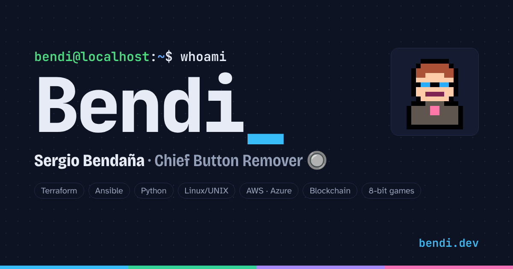
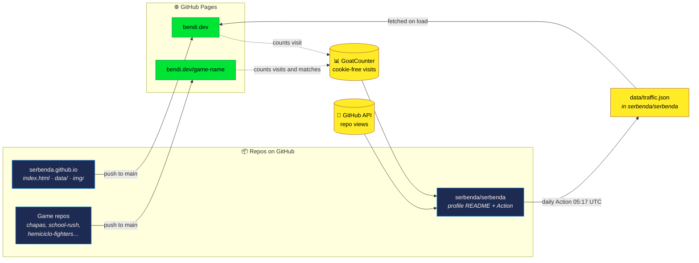
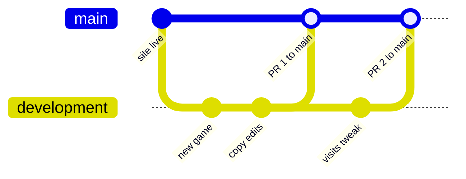

<div align="center">

<a href="https://bendi.dev/"></a>

# bendi.dev

**My personal website: who I am, the arcade zone with my games and the visits to each project.**

[](https://bendi.dev/)
[](https://github.com/serbenda/serbenda.github.io/deployments)
[](#-privacy)
[](https://github.com/sponsors/serbenda)


</div>

---

## 📑 Contents

- [What this repo is](#-what-this-repo-is)
- [How it works](#-how-it-works)
- [What's on the website](#-whats-on-the-website)
- [Repo structure](#-repo-structure)
- [Branches and workflow](#-branches-and-workflow)
- [Running it locally](#-running-it-locally)
- [Common tasks](#-common-tasks)
- [Privacy](#-privacy)
- [Fonts and licenses](#-fonts-and-licenses)

---

## 🧭 What this repo is

GitHub treats a repo named `<user>.github.io` in a special way: it publishes it with GitHub Pages as **the user's main website**. The [`CNAME`](CNAME) file serves that site on my own domain, **[bendi.dev](https://bendi.dev)**.

Not to be confused with my profile repo:

| | **serbenda.github.io** (this repo) | **[serbenda/serbenda](https://github.com/serbenda/serbenda)** |
|---|---|---|
| What it is | My public website | The README of my GitHub profile |
| Where you see it | [bendi.dev](https://bendi.dev) | [github.com/serbenda](https://github.com/serbenda) |
| Format | HTML + CSS + JS | Markdown |
| Who sees it | Anyone, no GitHub needed | People visiting my profile |
| Automation | None: it's static | A daily GitHub Action that collects the visits |

This domain is also **the root of all my games**. Each game lives in its own repo with its own GitHub Pages site, and GitHub hangs it from here automatically: the `chapas` repo is served at `bendi.dev/chapas`, `school-rush` at `bendi.dev/school-rush`, and so on.

---

## 🔧 How it works



In words:

1. **Publishing.** Whenever something lands on `main`, GitHub Pages publishes the site at `bendi.dev`. There is no build step: what's in the repo is what gets served (the [`.nojekyll`](.nojekyll) file stops GitHub from running it through Jekyll).
2. **Games.** Each game is published from its own repo and shows up at `bendi.dev/<repo-name>` on its own. What the website says about each one (title, blurb, tags and screenshot) lives in [`data/projects.json`](data/projects.json).
3. **Visits.** The website and the games load the **GoatCounter** script, which counts visits without cookies. Games also send a `partida/<repo>` event when a match starts.
4. **Daily collection.** Every morning at 05:17 UTC, the GitHub Action in [serbenda/serbenda](https://github.com/serbenda/serbenda) merges the GoatCounter visits and the GitHub API views into `data/traffic.json`. GitHub only keeps 14 days of repo views, so that file is what keeps the history.
5. **Reading.** When the page loads, the JavaScript fetches that `traffic.json` straight from the profile repo and draws the visits section. If that fails, it falls back to a local `data/traffic.json` if there is one.

---

## 🎮 What's on the website

| Section | Anchor | What it shows |
|---|---|---|
| Header | — | Terminal prompt, name, links to LinkedIn, GitHub, Sponsor and the **▶ PLAY** button |
| About me | [`#sobre-mi`](https://bendi.dev/#sobre-mi) | Career by role, from 2005 to today, and the tech stack |
| Arcade zone | [`#arcade`](https://bendi.dev/#arcade) | The games in 8-bit style, with screenshot, tags and a play button |
| Other projects | [`#otros`](https://bendi.dev/#otros) | Tools and projects that aren't games |
| Visits | [`#visitas`](https://bendi.dev/#visitas) | Visits and matches per project and per day |
| Let's talk | [`#contacto`](https://bendi.dev/#contacto) | Contact via LinkedIn and support on GitHub Sponsors |

The website is **bilingual** (Spanish and English), switched with the language button in the header. Translatable text carries a `data-t="key"` attribute, and the translations live in a dictionary inside `index.html` itself.

---

## 📁 Repo structure

```text
serbenda.github.io/
├── index.html        ← the whole website: HTML, styles and JavaScript in a single file
├── CNAME             ← custom domain: bendi.dev
├── .nojekyll         ← GitHub Pages serves files as they are, without Jekyll
├── data/
│   └── projects.json ← which games and projects appear on the site, in what order and with what text
├── img/
│   ├── bendi.svg     ← pixel-art avatar
│   └── games/        ← a screenshot of each game (.webp)
├── fonts/            ← self-hosted fonts (no Google Fonts) and their licenses
├── cv/               ← the CV: cv.html (source, both languages) and the PDFs generated from it
├── tools/cv/build.py ← prints cv/cv.html to both PDFs
├── og.html           ← template for og.png (1200×630), the image shown when the site is shared
├── og.png            ← social media preview image
└── header.html       ← template for the profile README banner (1280×320)
```

---

## 🌿 Branches and workflow

The repo has two branches, both protected:

| Branch | Purpose | Protection |
|---|---|---|
| **`main`** | Production. What's here is what you see on bendi.dev | Only changes through a **pull request** from `development`. Nobody can push directly (not even the admin), rewrite history or delete it |
| **`development`** | Day-to-day work. Changes are tested here | Normal pushes allowed, but no force pushes and no deletion |



The life of a change:

```bash
git checkout development
git pull
# … make changes …
git commit -am "Describe the change"
git push
# On GitHub: open a pull request from development → main, review and merge.
# GitHub Pages publishes bendi.dev within a couple of minutes.
```

---

## 💻 Running it locally

Nothing to install. From the repo folder:

```bash
python3 -m http.server 8000
```

and open <http://localhost:8000>. It has to be served like this (rather than opening the file with a double click) because the page loads `data/projects.json` with `fetch`, which browsers don't allow from `file://`.

---

## 🧰 Common tasks

<details>
<summary><b>Add a new game to the website</b></summary>

1. Publish the game with GitHub Pages in its own repo. It will show up at `bendi.dev/<repo>` on its own.
2. Save a screenshot as `img/games/<repo>.webp`.
3. Add an entry to [`data/projects.json`](data/projects.json) with `repo`, `title`, `img`, `tags` and the `es` and `en` blurbs. The order in the file is the order on the site.
4. The next day, the profile Action also adds it to the games table in the GitHub profile README.

</details>

<details>
<summary><b>Change a piece of text</b></summary>

Find its `data-t` key in `index.html` and change the translation in both dictionaries (Spanish and English) in the `<script>` of `index.html`.

</details>

<details>
<summary><b>Update the CV</b></summary>

1. Edit [`cv/cv.html`](cv/cv.html) (Spanish and English are in the same file). Keep the latest role in sync with `CAREER` in `index.html`.
2. Run `python3 tools/cv/build.py` (needs `pip install playwright` and `python -m playwright install chromium` the first time).
3. It rewrites `cv/Sergio-Bendana-CV-es.pdf` and `cv/Sergio-Bendana-CV-en.pdf`. Check them and commit.

</details>

<details>
<summary><b>Regenerate the share image or the profile banner</b></summary>

Open `og.html` (1200×630) or `header.html` (1280×320) locally, take a screenshot at exactly that size and save it as `og.png` in this repo or as `assets/header.png` in the profile repo.

</details>

---

## 🔒 Privacy

- **No cookies** and no advertising trackers.
- Visits are counted with **[GoatCounter](https://www.goatcounter.com/)**, which stores no personal data and uses no cookies.
- Fonts are **self-hosted** in `fonts/`, so the site never calls Google Fonts.

---

## 🔤 Fonts and licenses

The fonts in `fonts/` are licensed under the **SIL Open Font License**; each one ships with its `OFL-*.txt` file:

Press Start 2P · VT323 · JetBrains Mono · IBM Plex Sans · Atkinson Hyperlegible · Bricolage Grotesque

---

<div align="center">

<sub>Handmade by <a href="https://bendi.dev">Bendi</a> · If you enjoy the games, you can support them on <a href="https://github.com/sponsors/serbenda">GitHub Sponsors</a> ❤</sub>

</div>

## Probar el panel de visitas con datos de ejemplo

```bash
node tools/simular-visitas.mjs --en-vivo
```

Genera 60 días de visitas y partidas inventadas en `data/traffic.demo.json` (no se sube: está en `.gitignore`), arranca la web en tu ordenador y, con `--en-vivo`, sigue sumando visitas y partidas cada 3 segundos. Ábrela en <http://localhost:8080/?demo#visitas>: sale una banda amarilla avisando de que son datos de ejemplo. No se envía nada a GoatCounter ni a GitHub, y en bendi.dev el modo `?demo` no hace nada. Opciones: `--dias 120`, `--semilla 3`, `--puerto 9000`, `--sin-servidor`.
