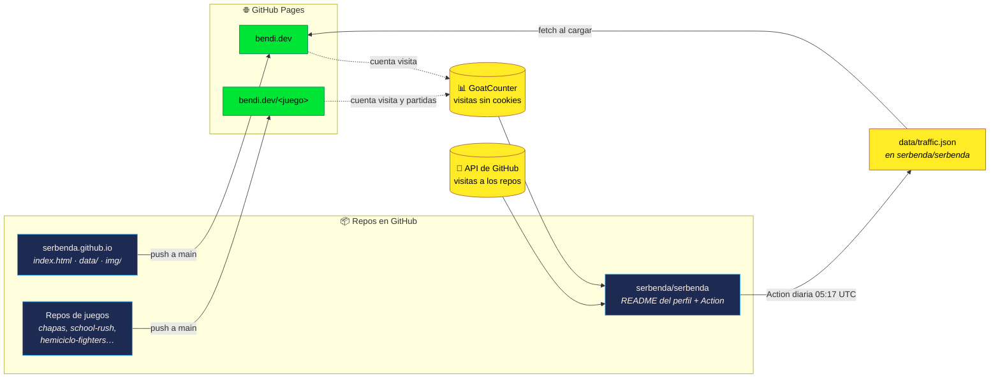
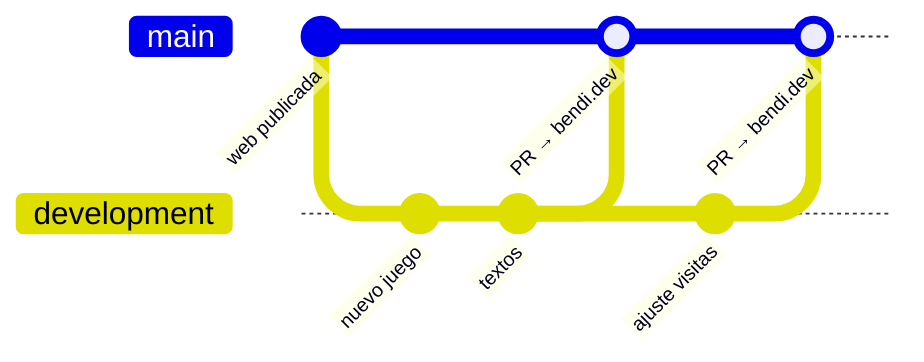

<div align="center">

<a href="https://bendi.dev/"></a>

# bendi.dev

**Mi web personal: quién soy, la zona arcade con mis juegos y las visitas de cada proyecto.**

[](https://bendi.dev/)
[](https://github.com/serbenda/serbenda.github.io/deployments)
[](#-privacidad)
[](https://github.com/sponsors/serbenda)


</div>

---

## 📑 Índice

- [Qué es este repo](#-qué-es-este-repo)
- [Cómo funciona](#-cómo-funciona)
- [Qué tiene la web](#-qué-tiene-la-web)
- [Estructura del repo](#-estructura-del-repo)
- [Ramas y flujo de trabajo](#-ramas-y-flujo-de-trabajo)
- [Probarla en local](#-probarla-en-local)
- [Tareas habituales](#-tareas-habituales)
- [Privacidad](#-privacidad)
- [Fuentes y licencias](#-fuentes-y-licencias)

---

## 🧭 Qué es este repo

GitHub trata de forma especial un repo que se llama `<usuario>.github.io`: lo publica como **la web principal del usuario** con GitHub Pages. Con el archivo [`CNAME`](CNAME) esa web sale en mi dominio, **[bendi.dev](https://bendi.dev)**.

No hay que confundirlo con el repo de mi perfil:

| | **serbenda.github.io** (este repo) | **[serbenda/serbenda](https://github.com/serbenda/serbenda)** |
|---|---|---|
| Qué es | Mi web pública | El README de mi perfil de GitHub |
| Dónde se ve | [bendi.dev](https://bendi.dev) | [github.com/serbenda](https://github.com/serbenda) |
| Formato | HTML + CSS + JS | Markdown |
| Quién lo ve | Cualquiera, sin entrar en GitHub | Quien visita mi perfil |
| Automatización | Ninguna: es estático | Una GitHub Action diaria que recoge las visitas |

Además, este dominio es la **raíz de todos mis juegos**. Cada juego vive en su propio repo con su propio GitHub Pages, y GitHub lo cuelga automáticamente de aquí: el repo `chapas` sale en `bendi.dev/chapas`, `school-rush` en `bendi.dev/school-rush`, etc.

---

## ⚙️ Cómo funciona



En palabras:

1. **Publicación.** Cada vez que algo entra en la rama `main`, GitHub Pages publica la web en `bendi.dev`. No hay compilación ni build: lo que hay en el repo es lo que se sirve (el archivo [`.nojekyll`](.nojekyll) evita que GitHub lo procese con Jekyll).
2. **Juegos.** Cada juego se publica desde su propio repo y aparece solo en `bendi.dev/<nombre-del-repo>`. Lo que la web cuenta de cada uno (título, texto, etiquetas y captura) está en [`data/projects.json`](data/projects.json).
3. **Visitas.** La web y los juegos cargan el script de **GoatCounter**, que cuenta visitas sin cookies. Los juegos además mandan un evento `partida/<repo>` al empezar una partida.
4. **Recogida diaria.** Cada mañana, a las 05:17 UTC, la GitHub Action de [serbenda/serbenda](https://github.com/serbenda/serbenda) junta las visitas de GoatCounter y las de la API de GitHub en `data/traffic.json`. GitHub solo guarda 14 días de visitas a los repos, así que ese archivo es el que conserva el histórico.
5. **Lectura.** Al abrir la web, el JavaScript descarga ese `traffic.json` directamente del repo del perfil y pinta la sección de visitas. Si falla, usa la copia local de `data/traffic.json` si existe.

---

## 🕹️ Qué tiene la web

| Sección | Ancla | Qué muestra |
|---|---|---|
| Cabecera | — | Prompt de terminal, nombre, enlaces a LinkedIn, GitHub, Sponsor y el botón **▶ JUGAR** |
| Sobre mí | [`#sobre-mi`](https://bendi.dev/#sobre-mi) | Trayectoria por puestos, de 2005 a hoy, y el stack |
| Zona arcade | [`#arcade`](https://bendi.dev/#arcade) | Los juegos en estilo 8 bits, con captura, etiquetas y botón para jugar |
| Otros proyectos | [`#otros`](https://bendi.dev/#otros) | Herramientas y proyectos que no son juegos |
| Visitas | [`#visitas`](https://bendi.dev/#visitas) | Visitas y partidas por proyecto y por día |
| ¿Hablamos? | [`#contacto`](https://bendi.dev/#contacto) | Contacto por LinkedIn y apoyo en GitHub Sponsors |

La web es **bilingüe** (español e inglés) con el botón de idioma de la cabecera. Los textos traducibles llevan el atributo `data-t="clave"` y sus traducciones están en un diccionario dentro del propio `index.html`.

---

## 🗂️ Estructura del repo

```text
serbenda.github.io/
├── index.html        ← la web entera: HTML, estilos y JavaScript en un solo archivo
├── CNAME             ← dominio propio: bendi.dev
├── .nojekyll         ← GitHub Pages sirve los archivos tal cual, sin Jekyll
├── data/
│   └── projects.json ← qué juegos y proyectos salen en la web, en qué orden y con qué textos
├── img/
│   ├── bendi.svg     ← avatar pixel art
│   └── games/        ← capturas de cada juego (.webp)
├── fonts/            ← fuentes autoalojadas (sin Google Fonts) y sus licencias
├── og.html           ← plantilla de og.png (1200×630), la imagen al compartir la web
├── og.png            ← imagen para redes sociales
└── header.html       ← plantilla del banner (1280×320) del README del perfil
```

---

## 🌿 Ramas y flujo de trabajo

El repo tiene dos ramas, las dos protegidas:

| Rama | Para qué | Protección |
|---|---|---|
| **`main`** | Producción. Lo que hay aquí es lo que se ve en bendi.dev | Solo se cambia mediante **pull request** desde `development`. Nadie puede hacer push directo (ni siquiera el administrador), forzar el historial ni borrarla |
| **`development`** | Trabajo diario. Aquí se prueban los cambios | Se puede hacer push normal, pero no se puede forzar el historial ni borrar |



El ciclo de un cambio:

```bash
git checkout development
git pull
# … cambios …
git commit -am "Describe el cambio"
git push
# En GitHub: Pull request de development → main, revisar y hacer merge.
# GitHub Pages publica bendi.dev en un par de minutos.
```

---

## 💻 Probarla en local

No hace falta instalar nada. Desde la carpeta del repo:

```bash
python3 -m http.server 8000
```

y abre <http://localhost:8000>. Hace falta servirla así (y no abrir el archivo con doble clic) porque la web carga `data/projects.json` con `fetch`, y los navegadores no lo permiten desde `file://`.

---

## 🛠️ Tareas habituales

<details>
<summary><b>Añadir un juego nuevo a la web</b></summary>

1. Publica el juego con GitHub Pages en su propio repo. Aparecerá solo en `bendi.dev/<repo>`.
2. Guarda una captura en `img/games/<repo>.webp`.
3. Añade una entrada en [`data/projects.json`](data/projects.json) con `repo`, `title`, `img`, `tags` y los textos en `es` y `en`. El orden del archivo es el orden en la web.
4. Al día siguiente, la Action del perfil también lo añade a la tabla de juegos del README de GitHub.

</details>

<details>
<summary><b>Cambiar un texto</b></summary>

Busca su clave `data-t` en `index.html` y cambia la traducción en los dos diccionarios (español e inglés) del `<script>` de `index.html`.

</details>

<details>
<summary><b>Regenerar la imagen para compartir o el banner del perfil</b></summary>

Abre `og.html` (1200×630) o `header.html` (1280×320) en local, haz una captura a ese tamaño exacto y guárdala como `og.png` en este repo o como `assets/header.png` en el repo del perfil.

</details>

---

## 🔒 Privacidad

- **Sin cookies** y sin rastreadores publicitarios.
- Las visitas se cuentan con **[GoatCounter](https://www.goatcounter.com/)**, que no guarda datos personales ni usa cookies.
- Las fuentes están **autoalojadas** en `fonts/`, así que la web no llama a Google Fonts.

---

## 🔤 Fuentes y licencias

Las fuentes de `fonts/` tienen licencia **SIL Open Font License**; cada una incluye su archivo `OFL-*.txt`:

Press Start 2P · VT323 · JetBrains Mono · IBM Plex Sans · Atkinson Hyperlegible · Bricolage Grotesque

---

<div align="center">

<sub>Hecho a mano por <a href="https://bendi.dev">Bendi</a> · Si te gustan los juegos, puedes apoyarlos en <a href="https://github.com/sponsors/serbenda">GitHub Sponsors</a> ❤</sub>

</div>
